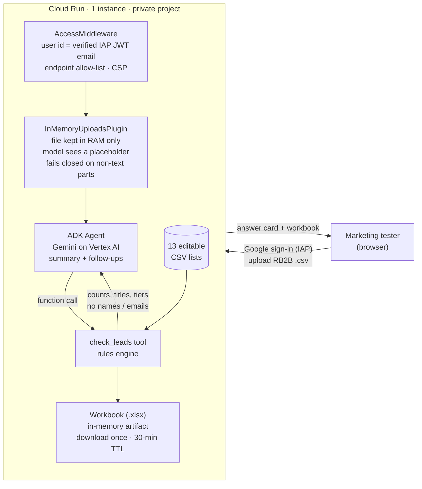
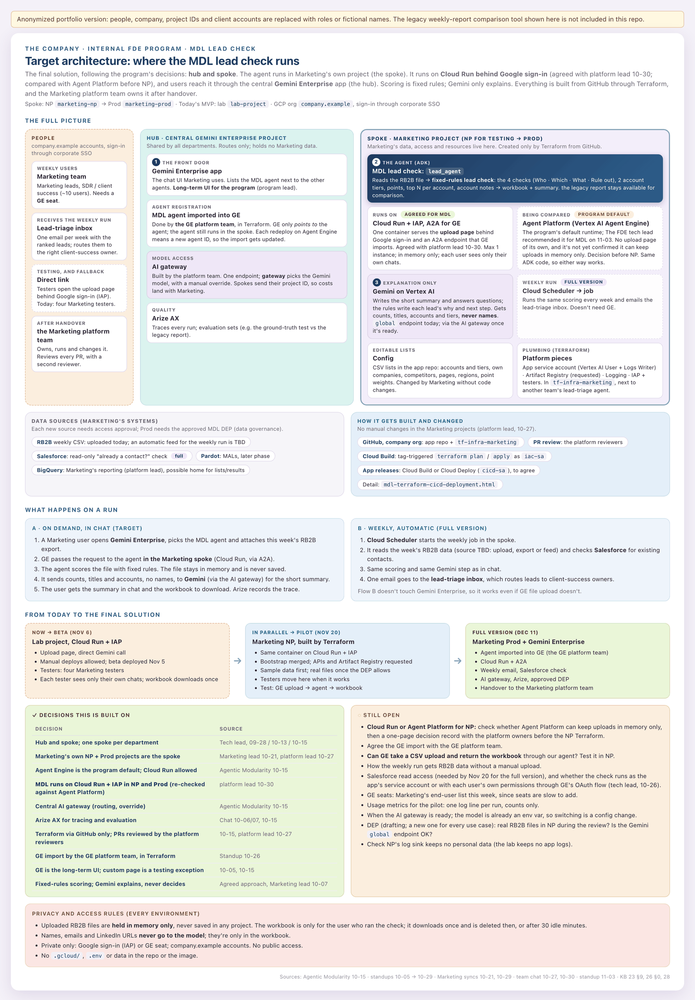

# Website-Visitor Lead Check Agent (Google ADK · Gemini · Cloud Run)

An agent that turns a weekly export of identified website visitors (from RB2B, a visitor-identification tool) into a **short, explainable answer per account**: who is worth contacting, why, and what to do next.

The design rule is **"rules decide, Gemini explains"**. A deterministic rules engine scores every visitor. Gemini only writes a 2–4 sentence summary and answers follow-up questions, and it never sees names or emails.

Built as a **forward-deployed engineering** engagement embedded with an enterprise **Marketing team** (internal client) at a large IT-services / AI-data company. The engagement covered discovery, reverse-engineering the manual weekly report, solution design, engineering, a security review, and the beta on Google Cloud.

> **Sanitized portfolio version.** All company, people, project and account names are replaced with placeholders or fictional names. The rule lists hold **sample data**. A comparison tool that ran a colleague's legacy script is removed, and the title classifier is rewritten as a simplified, self-contained rule set. No real visitor data, credentials or project identifiers are included.

## The problem

- Marketing received ~3,000 identified visitors a week (~33k raw rows across 3 exports). A manual spreadsheet sorted ~17,700 cumulative people into tiers, with **no reason per person and no next step**. Nobody followed up.
- The old "AI scoring" was a rules script that used **2 of 23** available fields. Reproducing it exactly surfaced 11 flaws, for example Tier 1 inflated ~17% by misclassified pages.
- What Marketing asked for: per key account, **a clear yes/no** for the few people who matter, with the reason and a next step.

## How it works



### The four checks (fixed rules, `lead_agent/lead_check/engine.py`)

| Check | Rule |
|---|---|
| **WHO** | Strong role from the job title: leads or buys AI/data work (heads, directors, VPs, chiefs, procurement) or does it hands-on (ML engineers, data scientists, researchers). Seniority alone isn't enough. Unclear titles go to a callback (`settle_titles`) that may later use Gemini on the title text only. |
| **WHICH** | Tier 1 = strategic ("whale") and priority existing accounts. Tier 2 = target accounts plus **new logos** (non-target, above a revenue band, never education). Matching uses email domain, website, aliases and company names, with domain-only matching for short or common names. |
| **WHAT** | Strong interest within the visit window (14 days to the newest visit): Contact Us or a solution page. Articles add points but aren't enough alone. Contact-center service pages don't count as Contact Us. |
| **RULE OUT** | Own staff (company and subsidiaries), competitors, wrong company matches from personal email, students/interns/job seekers, visitors outside the focus regions (country from city/state). Partners are flagged, not ruled out. |

**YES** = strong role + strong interest + Tier 1/2 + not ruled out. Points only **rank** the YESes: Contact Us +3, service page +2, leads/buys +2 or practitioner +1, article +1, came back another day +1, seen in the last 7 days +1. The engine keeps the **top N per account** (3 by default). Company-only visits from Tier 1/2 accounts become **account notes**. Each lead also gets an **ICP label** ("Physical AI", "GenAI data", both, or general), which never changes the result.

Every lead's **reason and next step are written by the rules**, so they are consistent and auditable. All weights and lists live in `lead_agent/lead_check/lists/*.csv`, which the business can change without a code change.

## Security and privacy (hardened after an independent review, before any user had access)

- **Per-user isolation:** on Cloud Run the ADK user id is the email in IAP's signed JWT, checked against Google's keys, issuer and (optionally) audience. A tester can only reach their own sessions and workbooks. `/run` bodies are checked so `appName` and `userId` match the caller.
- **Closed surface:** only the endpoints the chat page needs are open. ADK's developer UI and websockets run locally only, and the server refuses to start with the dev UI on Cloud Run.
- **Memory-only data:** uploads never become artifacts or files on disk. Workbooks are built in a RAM-backed temp dir, held as in-memory artifacts, **deleted when downloaded**, and swept after 30 idle minutes.
- **Prompt-injection / leak hardening:** file text is treated as data in the instruction. Page links lose query strings and credentials before they reach the model or page (`links.py`). Tool errors never forward exception text that could quote rows. Model markdown is sanitized (DOMPurify) and images are blocked. The CSP is strict.
- **Least privilege:** the runtime service account can only call Vertex AI and write logs. Local runs use a **project-only gcloud config** (`CLOUDSDK_CONFIG=./.gcloud`) through a refresh handler, never the machine-wide ADC login.
- Pinned front-end libraries are vendored with SHA-256 checksums (`ui/vendor/SHA256SUMS`).

## Diagrams

Anonymized architecture diagrams: previews in [`docs/diagrams/`](docs/diagrams/README.md), interactive versions on [GitHub Pages](https://ovsilya.github.io/website-visitor-lead-check-agent/diagrams/target-architecture.html).

<a href="docs/diagrams/README.md"></a>

## Repository layout

```
server.py              ADK FastAPI app + chat page, in-memory services, idle sweeper, download-once
access.py              IAP JWT identity, endpoint allow-list, body-size cap, security headers
lead_agent/
  agent.py             ADK Agent (Gemini on Vertex AI) + App with the uploads plugin
  tools.py             check_leads tool (@_safe error wrapper, workbook artifact)
  uploads.py           InMemoryUploadsPlugin: strips uploads from the request, holds bytes in RAM
  auth.py              project-only gcloud credentials (refresh handler)
  links.py             page_link(): scheme + host + path only
  lead_check/
    engine.py          the four checks, points, top N, account notes, ICP labels, chat summary
    titles.py          WHO: role strength from job title (simplified rules for this version)
    lists.py           loads the editable CSV lists
    workbook.py        4-sheet Excel workbook + "Read me"
    lists/*.csv        accounts & tiers, aliases, company names, own companies, competitors,
                       partners, pages, ICP rules, regions, personal email domains, settings
ui/                    chat page (vanilla JS, marked + DOMPurify, pinned)
tests/                 rules, rule-outs, ICP labels, privacy, web security (synthetic data)
docs/diagrams/         anonymized architecture diagrams (HTML + PNG previews)
deploy.sh, grant-tester.sh, run.sh, gcloud.sh, Dockerfile
```

## Run locally

```bash
python3.13 -m venv .venv && .venv/bin/pip install -r lead_agent/requirements.txt pytest httpx
cp lead_agent/.env.example lead_agent/.env        # set GOOGLE_CLOUD_PROJECT
./gcloud.sh auth login you@example.com            # project-only sign-in, once
./run.sh                                          # http://localhost:8000  (ADK_DEV_UI=1 adds /dev-ui/)
```

The rules engine also runs without the agent:

```bash
.venv/bin/python -m lead_agent.lead_check export.csv --out leads.xlsx --top-n 3
```

## Tests

```bash
.venv/bin/python -m pytest tests -q      # 18 tests, synthetic data, no model calls
```

The tests cover the four checks, ranking and top N, account notes, ICP labels, students / own staff / partners, names kept out of the chat summary, IAP token verification, the endpoint allow-list, per-user isolation, download-once, and the upload plugin. The internal version also had a ground-truth test that reproduced the manual report's counts across ~17,700 people. It is not included because it needs real data.

## Deploy (Cloud Run + IAP)

`deploy.sh` builds from source with dedicated runtime and build service accounts and `--no-allow-unauthenticated`. It allows at most 1 instance, sets the env vars, and enables IAP through the Cloud Run API. `grant-tester.sh` adds or removes `roles/iap.httpsResourceAccessor` per tester.

**Target design (planned, see `docs/diagrams/target-architecture.html`):** hub-and-spoke projects. The agent runs in the business unit's own project and is imported into **Gemini Enterprise** through **A2A**, with Vertex AI **Agent Engine** evaluated as the runtime. Model calls go through a central **AI gateway**, and a weekly **Cloud Scheduler** job emails the shortlist. Infrastructure is managed with **Terraform** from GitHub (plan/apply on git tags via Cloud Build), with Workload Identity Federation for GitHub Actions pipelines.

## Results (internal engagement, as of Nov 2026)

- Use case chosen from a 23-idea backlog. The design was approved by Marketing leadership, and the MVP reproduced the legacy report exactly.
- **Beta live on schedule** (Nov 6) after an independent security review. Both blocking findings and every fix-now item were closed before users got access.
- Coverage widened from 6 strategic accounts to **127+ accounts** in two tiers, plus new logos.
- The business owns the rules: **13 editable lists**, so answers ship as list edits, not code.
- Expected impact, still to be measured in the pilot: a weekly shortlist instead of a ~17,700-row workbook, and about 35 hours a month of manual work saved (estimate).

## Tech stack

Python 3.13 · Google ADK 2.x (agents, tools, plugins, sessions/artifacts, API server) · Gemini on Vertex AI · pandas · openpyxl · FastAPI/uvicorn · pytest · Cloud Run · Identity-Aware Proxy · IAM · Cloud Build · Artifact Registry · Docker · vanilla JS (marked, DOMPurify) · planned: Terraform, Gemini Enterprise (A2A), Agent Engine, Workload Identity Federation
